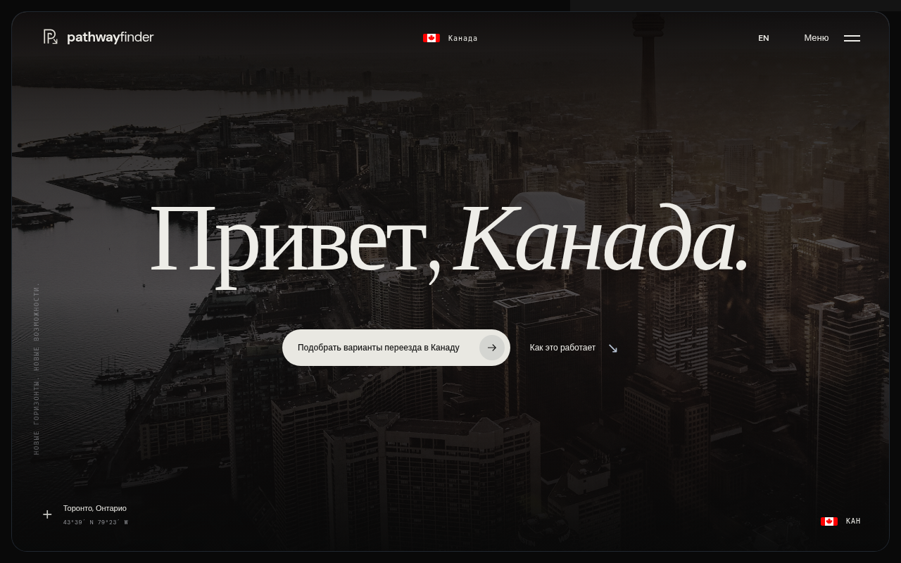
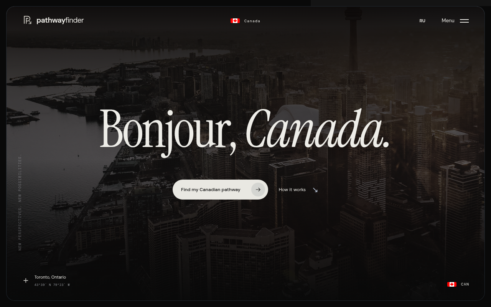
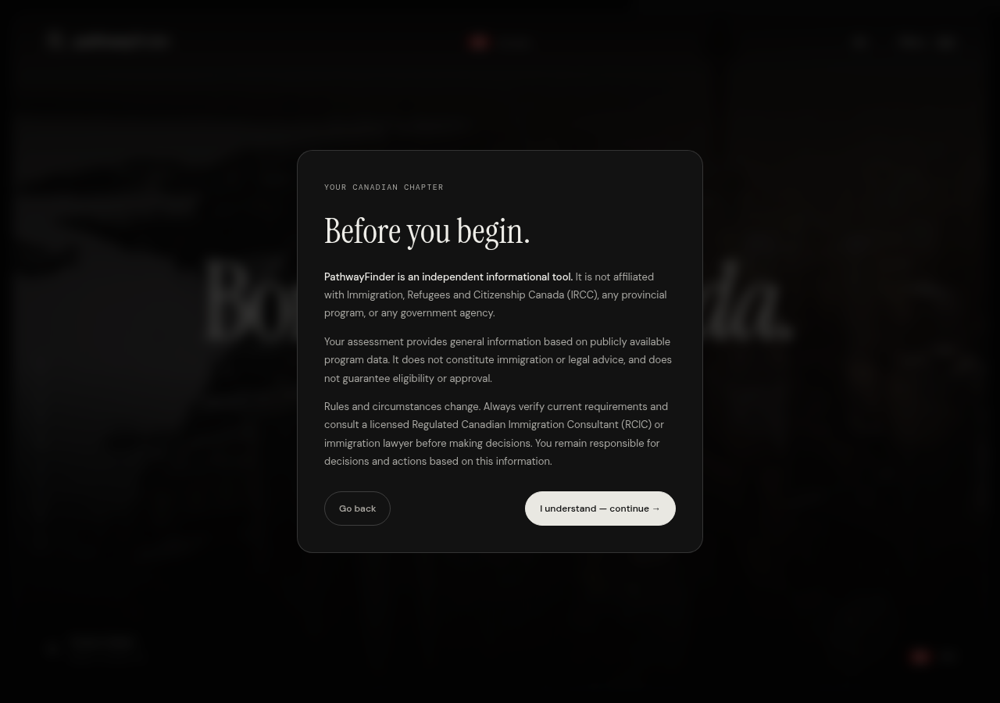
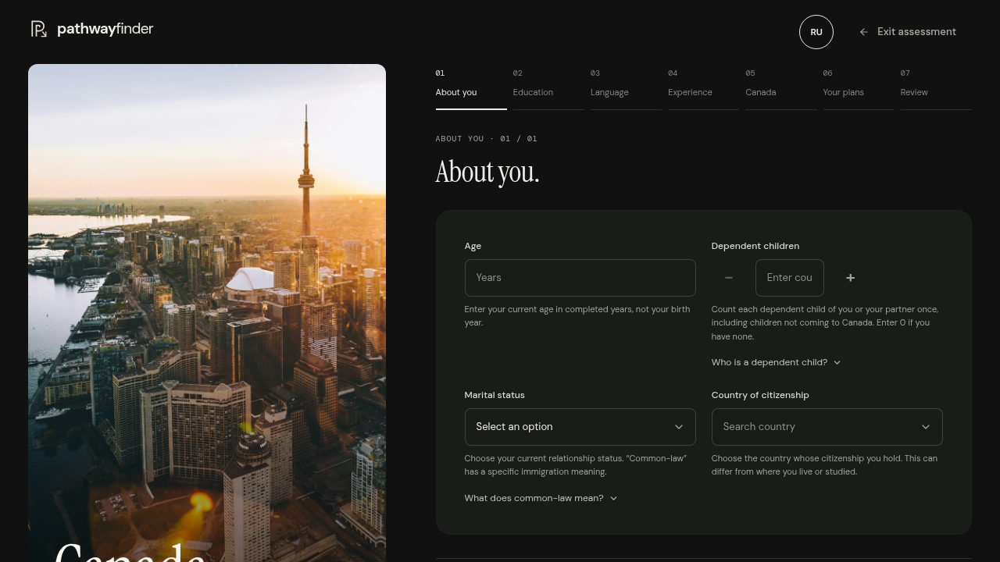
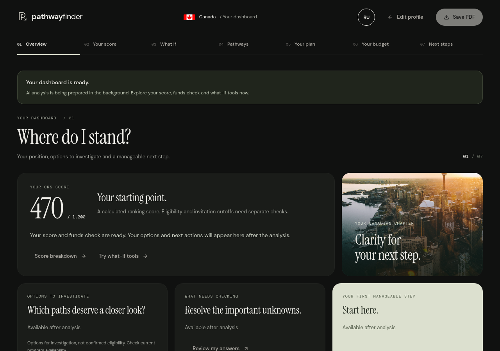
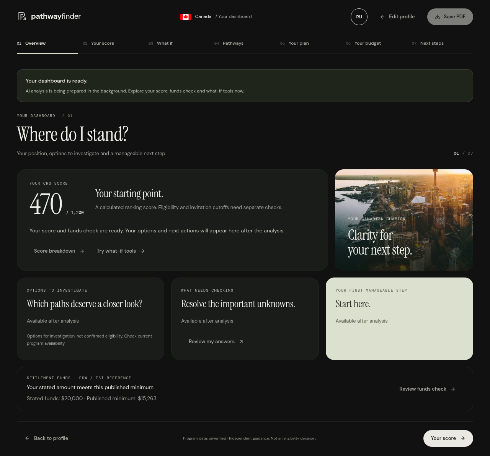

# PathwayFinder

**A software solution for Canadian immigration consultants (RCIC).**

PathwayFinder is a web application I designed and built to help a consultant run a first consultation and client intake for Canadian immigration: collect a client's profile in a structured way, calculate their Comprehensive Ranking System (CRS) score, check settlement funds, explore "what if" scenarios, and hand over a clear written brief.

This is version 2.4.1, tested end to end. There is no public demo link. A walkthrough is available on request.

## Screenshots

All screenshots use fake sample data only.

| Home (Russian) | Home (English) |
|---|---|
|  |  |

**Disclaimer shown before every assessment**

**Structured intake: a 7-step questionnaire (About you, Education, Language, Experience, Canada, Your plans, Review)**

**Results dashboard (fake sample profile)**

## The problem

First consultations in immigration practice involve a lot of repetitive work: gathering the same profile details, converting language test results, working out a CRS score, and explaining options and costs to the client. PathwayFinder structures and partly automates the consultant's intake and first-assessment step, so more of the meeting is spent on advice and less on data collection.

## Key features

These are the features that exist in the app's code:

- **7-step guided questionnaire** with grouped questions, inline help, validation and an editable review step. Includes a NOC occupation lookup and language-test score entry.
- **CRS score calculator** with a category-by-category score breakdown. Scoring logic is a pure, separately tested module.
- **"What if" tab** to see how the score could change under scenarios (for example, improved language results), recalculated together.
- **Pathways** to investigate (options for review, not eligibility decisions).
- **Plan** with a suggested sequence of steps, estimated time and cost, and a month-by-month view.
- **Budget and funds check:** estimated costs, and a comparison of the client's stated settlement funds against the published Express Entry minimum.
- **Next steps** to keep the report, revisit answers, or start gathering notes.
- **AI-written explanatory report** generated through the OpenAI API against a strict JSON schema. Scores, funds and calculations are computed by code, not by the model.
- **PDF brief** of the report, generated by a small Python service.
- **English / Russian toggle** across the interface and the PDF.
- **Optional save-and-resume** of questionnaire answers in the user's own browser.

## Tech stack

From the project's `package.json` and source layout:

- **Frontend:** React 18, Vite 6, Tailwind CSS 4, TypeScript tooling, GSAP and Motion for animation, Embla Carousel, Lucide icons
- **Backend:** Node.js serverless functions (OpenAI Responses API integration, report validation)
- **PDF generation:** Python with ReportLab
- **Testing:** Node's built-in test runner (CRS, report, language and rendering tests)

## My role

Product idea, design and full-stack build by Bakhytzhan Ibrayev.

## Sample data

No real client data is used here. Everything shown in the screenshots is sample data.

## Disclaimer

PathwayFinder is not affiliated with Immigration, Refugees and Citizenship Canada (IRCC), any provincial program, or any government agency. Nothing here is immigration or legal advice, and nothing guarantees eligibility or approval. Rules change: always verify current requirements and consult a licensed Regulated Canadian Immigration Consultant (RCIC) or immigration lawyer.

## Source code

The source code is private and available for review on request.

---

© 2026 Bakhytzhan Ibrayev. All rights reserved.
